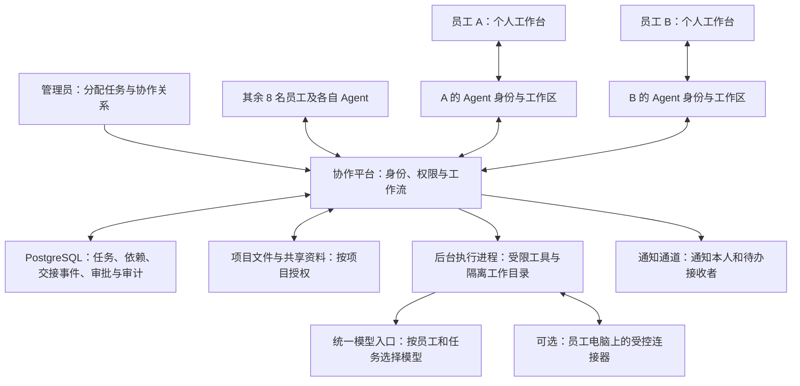

# 十人 Agent 协作方案

日期：2026-11-01。状态：设计方案，尚未实施。

适用场景：同一公司约 10 名员工，各自有不同任务，部分任务存在上下游依赖；允许替换模型，保留人工验收与审计。

## 1. 建议的部署方式

集中部署一个协作平台，为每人分配独立 Agent 身份、任务空间、记忆、工具权限和模型策略。Agent 按任务被唤起，执行进程按需分配，不要求 10 个模型持续运行。

初期采用一个模块化应用、一个 PostgreSQL 数据库、受控文件存储和独立后台执行进程。先设置 2–4 个并发执行槽，之后按工作量、模型限额和工具资源调整。这是起始配置建议，不是已验证的容量承诺。

纯文件整合与分析可以在服务器执行，员工电脑不需要持续开机。确实需要访问员工本机文件、桌面 Excel 或其他客户端的步骤，再配置该员工的本地连接器。连接器离线时，相关步骤等待设备上线，不误报完成。

工作任务、人工确认和交接状态由平台保存。聊天和通知是操作入口，不承担任务状态存储。

## 2. A 完成后，B 的 Agent 怎样继续

示例：A 整合部门 Excel，B 根据整合表生成经营分析，你验收最终成果。

| 步骤 | 负责人 | Agent 工作 | 进入下一步的条件 |
|---|---|---|---|
| 整合数据 | A | 按指定技能整合、去重、检查异常、生成结果 | 检查通过；本流程配置为由 A 确认 V1 |
| 分析结果 | B | 读取交接的 V1，计算指标，形成分析草稿和异常说明 | 输入权限与格式检查通过；分析由 B 验收 |
| 最终审批 | 你 | 汇总文件、预览和处理记录 | 你明确确认本版结果 |
| 正式分发 | 指定执行身份 | 向预设收件人发送已批准文件 | 审批仍有效，文件和收件人版本一致 |

执行链：

1. 管理员在项目中声明 B 的任务依赖 A 的指定成果，配置接收者、交付字段、技能、截止时间和审批规则。
2. A 的 Agent 完成文件处理，提交成果 V1 和检查报告。需要人工验收时，先等待 A 确认。
3. 平台校验完成条件，在同一数据库事务中记录 A 步骤完成、成果版本与项目授权，并写入待交接事件。
4. 后台交接程序根据已经批准的依赖关系，为 B 的 Agent 生成待处理工作并记录接收状态。
5. B 的 Agent 验证事件、任务状态、文件权限、输入格式和版本后接手；权限、输入或依赖不满足时明确阻塞并说明原因。
6. 如果任务预先允许自动准备草稿，B 的 Agent 立即执行并通知 B。配置为必须由 B 接单的工作，则先通知 B，待其接单再执行。
7. B 收到的消息应包含上游成果、当前版本、已经完成的工作、待决定的问题、查看入口和截止时间。
8. B 验收后，再按流程进入你的审批或下一个任务。正式外发沿用版本绑定与明确审批。

示例通知：

> A 已交付“部门报表整合”V1。你的 Agent 已根据该版本生成分析草稿，发现 2 处数据异常，需要你确认处理方式。任务截止时间为今天 17:00，可查看原表、检查报告与分析草稿。

上述异常数与时间仅示范通知形式。平台不会凭 Agent 在聊天中说“做完了”就推进流程；必须满足任务定义的检查与批准条件。

## 3. 共享哪些信息

| 信息范围 | 默认访问者 | 典型内容 |
|---|---|---|
| 个人空间 | 员工本人及其获准执行身份 | 个人记忆、私人笔记、未发布草稿 |
| 项目空间 | 项目成员，按角色细分 | 项目需求、正式成果、检查报告、交接记录 |
| 公司知识 | 经授权的员工范围 | 通用制度、模板、公共技能 |

共享单位是明确发布的成果和事实。A 的完整聊天记录、个人账号凭据和其他项目文件不会因为 A、B 参与一个协作任务就自动共享。

交接单至少包含：

| 字段 | 用途 |
|---|---|
| 事件编号、项目编号、流程实例编号 | 定位和去重 |
| 上游任务编号、任务版本、成果版本与内容摘要 | 绑定准确输入 |
| 发送执行身份、目标任务、目标 Agent 身份 | 确定归属和路由 |
| 工作摘要、验收结果、待解决问题、下一步技能 | 让接收方知道怎么继续 |
| 文件引用、来源和共享范围 | 经鉴权获取成果，不传递私人登录信息 |
| 产生时间、截止时间、关联审批记录 | 跟踪时限与责任 |

Agent 只能通过平台获取获准文件，文件下载和知识检索都要检查权限；不能只依赖提示词要求 Agent 保密。共享材料中的文字也不能自行授予权限、修改审批规则或增加收件人。

## 4. 可靠交接的实现

第一版用 PostgreSQL 中的持久任务表、交接事件表、待发送表和接收记录即可，不必同时部署多个消息中间件。PostgreSQL 官方文档说明 `SKIP LOCKED` 可用于多个消费者处理队列式表；它适合任务领取，不应用来替代一般业务一致性读取。[官方文档](https://www.postgresql.org/docs/current/sql-select.html)

- **完成与交接一起落库：** A 完成状态与交接事件在同一事务提交。失败则都不生效，后台程序重启后继续处理未完成交接。
- **允许重投，业务去重：** 交接事件可以重试。按事件编号和目标 Agent 建唯一约束，避免重复生成 B 的任务；不承诺外部发送可以无条件做到“恰好一次”。
- **领取有时限：** 执行进程领取任务后获得租约并保持心跳。异常退出后，租约过期可回收；恢复执行需要核对阶段检查点及副作用记录。
- **分开记录状态：** 已完成、待交接、B 已接收、B 执行中、等待 B 确认是不同状态。通知渠道提交成功不等于 B 已读或任务接手。
- **输入版本固定：** B 的执行和审批绑定 A 的成果 V1。如果 A 交付 V2，依据版本规则将 B 的旧结果标为需复核，正在执行的任务在检查点停止或重算，不能悄悄替换输入。
- **防止旧进程发布：** 每次领取有执行代次；发布结果前再次核对任务版本、输入版本和租约。过期执行者不得提交新结果。
- **外发结果未知：** 网络超时可能发生在渠道接受之后。保留未知状态，使用渠道支持的幂等能力或人工核对，不盲目重发。已外发的旧文件不能靠修改本地状态撤回。
- **异常有负责人：** 超过重试次数、输入不足、员工离线或审批逾期，转为明确的阻塞状态，只向相关负责人发送需要行动的提醒。
- **协作关系受控：** 默认使用无环依赖图。Agent 可以提出加步骤或找人协助的建议，由有权限的人批准后才改变流程。返工通过新版本或明确返工步骤表达，避免互相无限唤起。

若后续出现大量跨天等待、补偿、复杂并行汇合，可评估 Temporal。其 Signals 和 Updates 可用于流程消息与人工操作；引入时应统一编排归属，不让两套调度器同时推进同一任务。[Temporal 文档](https://docs.temporal.io/encyclopedia/workflow-message-passing)

## 5. 身份、隔离和模型

先接入企业登录或受控员工账号。员工身份来自认证会话；设备和执行进程使用各自的服务身份。每个项目、任务、文件、事件都记录公司及负责人，并校验项目成员关系。禁止接受消息正文自报身份来获得权限。

数据库增加按员工与项目的行级限制作为补充，应用服务也必须验证权限。PostgreSQL 的表所有者通常不受行级策略限制，因此日常应用角色不能使用超级用户、绕过行级安全的角色或依赖表所有者权限运行。[行级安全文档](https://www.postgresql.org/docs/current/ddl-rowsecurity.html)

每位员工的执行环境使用独立工作目录、受限工具与资源配额。执行任意脚本或访问敏感系统时，用容器、独立系统身份或独立节点形成实际隔离；只有“不同聊天窗口”不构成隔离。

模型统一经管理员配置的入口调用。不同员工和步骤可选不同模型，并记录模型版本、提示词版本、技能版本、调用量和成本。涉及限定内网数据时，路由策略必须禁止外部模型及外部备用模型。

简单提醒、身份校验、版本比较、依赖判断和计算由程序完成；理解、规划和文字分析按任务使用模型。可评估 LiteLLM 实现多部署路由和故障切换，具体可用功能与许可证按部署版本核对。[路由文档](https://docs.litellm.ai/docs/routing)

## 6. 对现有项目的改造

| 现有位置 | 改造内容 |
|---|---|
| `core/database.py` | 将业务存储迁至 PostgreSQL，增加员工、项目、依赖、交接事件、任务租约和审计；把旧 `pilot-owner` 映射为一个真实员工身份 |
| 新增 `identity/` | 员工登录、执行身份、角色、项目成员和文件授权 |
| 新增 `agents/` | Agent 配置、私人工作区、模型策略、技能允许列表和用量配额 |
| 新增 `collaboration/` | 任务依赖、交接单、事件投递与接收去重、版本失效规则 |
| `workflows/service.py` | 从单人验收扩展为带负责人、依赖和审批人的多步骤流程 |
| `workflows/artifacts.py` | 项目成果存储、版本授权与经鉴权的下载，保留内容摘要校验 |
| `runtime.py` | 将后台任务移到独立持久执行进程，HTTP 服务重启不丢任务 |
| `models/` | 按员工和任务配置模型，记录使用量，执行数据路由限制 |
| `channels/` | 通知与流程解耦；保留已验证通道，另选团队正式通知渠道 |
| `web/` | 个人任务页、项目协作页、审批页与管理员总览 |
| 可选 `connectors/` | 员工设备主动连接服务器，只领取获准的本机任务，离线可恢复 |

现有本机浏览器令牌、固定单用户归属和微信绑定不能直接作为 10 人企业认证方案。内部 Agent 交接通过平台完成，不依赖微信机器人能否跨联系人发送。

## 7. 分阶段落地与验收

**第一步：两个测试员工跑通交接。** 建立 A、B 身份和私有空间；配置一个“整合→分析→你审批”的项目；从工作台完成通知与验收。复用现有 Excel 技能。

验收：A 未完成时 B 不执行；A 交付正确版本后 B 自动接手；重复事件不重复建任务；无权限员工不能读项目文件；缺少必需输入时准确阻塞。

**第二步：扩大到 10 人。** 配置每人任务、共享项目和技能，加入并行执行、统一管理页、预算与人工接单选项，按实际需求接企业通知渠道和本机连接器。

验收：10 人可同时持有不同任务，执行按并发配额排队；员工无法读取其他人的私有资料；需要本机工具的任务在设备离线时等待，服务器任务继续运行。

**第三步：故障和运维验收。** 做数据库备份恢复、任务执行进程异常退出、交接重投、旧版本替换、审批逾期、外发超时和模型不可用演练。

验收：重启后从正确阶段继续；过期执行者不能发布；旧结果不被自动当作新结果审批；失败任务明确显示负责人、原因和下一步动作。

方案实施后，管理员应能从一个项目页面看到：谁负责、依赖谁、交付了哪个版本、谁已接手、正在等待谁，以及哪些操作由人批准。
