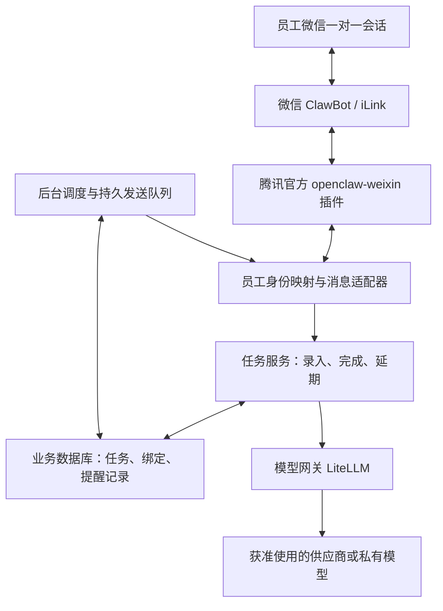

# 微信工作助理 · v0.1 方案与接入

本文件记录初版设计。微信适配器现已实现、官方依赖已安装，当前扫码与联调状态以 [微信接入说明.md](微信接入说明.md) 为准。

编制日期：2026-11-01（北京时间）。目标：公司内部服务，先由本人试点，模型供应商与部署方式可替换。

## 1. 微信 ClawBot 核实结果

本方案中的 ClawBot 指微信接入 OpenClaw 的官方通道。优先采用腾讯开源的 [`Tencent/openclaw-weixin`](https://github.com/Tencent/openclaw-weixin)，不是第三方同名机器人。

核实到的能力：

- 官方插件支持扫码授权、同一 Gateway 配置多个账号，以及文本和多种媒体收发。
- 入站使用 HTTP 长轮询；账号凭证和会话上下文由插件维护。业务服务不再使用第二个程序竞争拉取同一账号。
- 多账号需要明确隔离会话，并在出站时指定账号，避免根据最近活跃会话猜测收件人。
- `botAgent` 是观测标识，不是身份凭证，不能拿来作为员工身份或权限依据。

来源：[官方 README](https://github.com/Tencent/openclaw-weixin/blob/main/README.md)、[官方协议说明](https://github.com/Tencent/openclaw-weixin/blob/main/docs/protocol.md)。

**主动提醒的真实边界仍需本人账号验证。** 官方协议建议回复时回传入站 `context_token`；文档明确说明客户端允许字段缺失，并不证明服务端必然接受。当前资料不能建立“长期不互动也可无限主动发送”“消息必达”“接口成功等于本人已读”等承诺。不套用公众号客服消息窗口，也不虚构 ClawBot 的固定有效期。

官方 issue 中存在发送返回成功但手机不可见、扫码环境风险等用户报告。这些是个案报告，不能推定所有账号都有问题，但说明必须验证终端可见性：[示例 #355](https://github.com/Tencent/openclaw-weixin/issues/355)。

第一期按本人微信的一对一会话设计。群聊、统一公司品牌、批量管理员代绑、组织级 SLA、商用额度和员工批量授权尚未从已核实资料中确立，暂不列为可交付前提。员工逐人授权及各自会话入口需要实际确认。

## 2. 产品范围

第一期只处理五件事：记录任务、列待办、到点提醒、回复完成、稍后再提醒。每次回复标明事项编号。

例子：

```text
我：30 分钟后提醒我回复客户报价。
助理：已记录 #12 回复客户报价，今天 15:30 提醒。

助理（15:30）：待办提醒 #12：回复客户报价。
我：10 分钟后提醒 12。
助理：改为 15:40 再提醒；原截止时间保留。

我：完成 12。
助理：已完成，停止后续提醒。
```

当前本地原型已实现以上流程；真正微信中的对话需要完成适配。没有读取邮件、日历或工作文件，因此“主动”当前体现为主动触发提醒，尚无自动发现遗漏待办的能力。

## 3. 建议架构



当前交付实现了任务服务、SQLite 状态、单进程检查、演示发送和模型调用接口。微信适配器、企业数据库、外部持久队列和 LiteLLM 部署属于下一阶段。

### 职责与状态归属

| 模块 | 职责 | 事实保存位置 |
|---|---|---|
| 微信插件 | 登录、收消息、维护渠道上下文、发消息 | 插件状态目录；凭证不交给模型 |
| 身份映射 | 将账号与微信 peer 映射到员工 | 企业身份与绑定表 |
| 任务服务 | 保存事项、截止时间、完成和延期 | 业务数据库 |
| 调度器 | 按计划发现到期工作 | 持久任务状态 |
| 发送队列 | 去重、出站状态、失败或未知结果 | outbox 表及运行记录 |
| 模型网关 | 统一接入、允许模型、预算和路由 | 网关配置与用量记录 |

任务应保存 employee_id、组织、原截止、下次提醒、状态、版本、来源和创建记录。不要用聊天记忆代替这些字段。不同员工的“完成 12”必须在服务端校验归属。

### 从个人扩展到员工

OpenClaw 官方安全说明把一个 Gateway 定义为一个信任边界。个人私有助理建议分配独立运行身份、工作目录、凭证和工具授权；需要严格隔离时分开 Gateway／系统用户或主机。多聊天会话配置仅解决会话路由，不自动构成企业权限隔离。

公共部门助理另设身份，只接部门资料，不能复用个人邮箱或个人微信凭证。来源：[OpenClaw 安全说明](https://docs.openclaw.ai/gateway/security)。

## 4. 模型自由调配

第一期定义 `reminder-fast` 和 `planner-strong` 两个业务别名，由管理员在 LiteLLM 映射到实际模型。当前程序只选择一个意图理解模型；后续才按任务类别分别选择。

- 截止时间扫描、事项归属、完成和去重：普通程序执行。
- 自然语言提取事项与时间：经过实测的低成本模型。
- 风险分析、项目复盘等复杂任务：强模型，后续增加。
- 内网限定数据：路由到私有模型，禁止外部备用模型；这项策略必须由路由配置执行。
- 供应商故障：仅在批准且能力验证通过的模型间备用。模型输出无效时澄清或报错，不擅自改任务。

LiteLLM 支持多供应商、兼容接口、本地模型适配、虚拟密钥、预算、路由与备用。企业登录、审计等部分功能有商业版边界，需要逐项选用。自托管网关不代表外部模型调用的数据留在内网。

来源：[供应商列表](https://docs.litellm.ai/docs/providers)、[路由](https://docs.litellm.ai/docs/routing)、[版本功能边界](https://docs.litellm.ai/docs/enterprise)。

## 5. 官方插件接入路径

本轮未安装 OpenClaw，也未扫码登录或发送微信。以下是给下一步部署使用的官方命令，需在独立试点环境执行。

1. 安装并启动受支持的 OpenClaw 版本，先验证模型可用。官方微信仓库主分支 `package.json` 核实为插件 2.4.10；实际部署记录安装版本、OpenClaw 版本与仓库提交，固定已验证组合。版本要求以部署当时双方文档为准。
2. 安装、启用官方插件：

```text
openclaw plugins install "@tencent-weixin/openclaw-weixin"
openclaw config set plugins.entries.openclaw-weixin.enabled true
openclaw channels login --channel openclaw-weixin
```

3. 本人用微信扫码并确认授权。本人先向 Bot 发一条消息，核对手机回复可见。登录涉及的账号确认需要本人完成。
4. 多账号时按官方方式设置会话范围：

```text
openclaw config set session.dmScope per-account-channel-peer
openclaw gateway restart
openclaw channels status
```

5. 用官方插件自身完成普通收发和延迟发送测试，确认账号在该环境可工作。不要先引入自研桥接，使问题难以定位。
6. 开发消息适配器：验证真实入站账号与 peer，映射员工，规范化消息，再调用任务服务；调度到点后走官方插件的出站能力，显式指定绑定账号和目标。

**待开发接口合同：** 入站建议 `{account_id, peer_id, source_message_id, text, received_at}`；源消息 ID 按账号、peer 做持久去重。身份从可信通道映射，不能接受消息文本自报 employee_id。出站建议 `{employee_id, account_id, peer_id, task_id, task_version, client_id, text}`。这些是本方案的内部合同，不是腾讯 API 字段的承诺，也不是当前已上线接口。

OpenClaw 适配器→任务服务应采用单独的服务凭证或本机受控通道。当前页面使用的本机访问令牌仅服务浏览器原型，不能直接用作企业桥接认证方案。

## 6. 发送可靠性与验收

真正微信出站建议保存这些状态：

```text
pending → sending → submitted_unverified
                  → failed
                  → unknown
submitted_unverified → user_confirmed（本人回复确认）
pending → cancelled（事项完成／延期）
```

- 接口返回成功先记为“已提交、终端未确认”，不记为本人已读。
- 网络超时可能发生在服务端接受后：记为未知，不能无条件重发。
- 业务去重键用 task_id + task_version + reminder_slot。渠道是否支持 client_id 幂等需验证，不能凭字段名承诺不重复发送。
- 事项完成或延期时取消旧版本的待发消息；已被渠道接受的消息无法靠本地改状态撤销。
- 渠道凭证失效或会话不可用时标记待处理，管理端显示；需要员工重新互动或扫码时明确提示。
- 本地调度不负责替微信创造可用会话。没有回执能力时保留“未知”，依靠本人确认验收。

### 本人微信试点清单

| 场景 | 验收方式 | 当前状态 |
|---|---|---|
| 扫码、入站、普通回复 | 本人手机确实可见 | 待实测 |
| 收到消息后延迟 5 分钟提醒 | 手机可见且能回复完成 | 待实测 |
| 无新互动数小时、隔夜 | 记录每次手机可见性和接口结果 | 待实测 |
| Gateway 与任务服务分别重启 | 计划仍在，收件账号正确，无额外提醒 | 待实测 |
| 网络中断后恢复 | 失败与未知结果分开，无盲目重复发送 | 待实测 |
| 完成、取消、延期 | 业务状态与下次提醒一致 | 本地原型已测试，微信待联调 |
| 模型切换 | 相同指令的解析和权限检查仍正确 | 替身接口已测，真实模型待联调 |
| 第二名员工 | 无法读写另一员工事项或凭证 | 企业认证与隔离待开发 |

## 7. 部署分期

### v0.1：本轮交付

本机页面、单用户持久任务、演示通道、模型接口、关键测试与接入方案。运行默认不调用模型、不发送微信。

### v0.2：本人真实微信试点

独立常驻环境＋腾讯官方插件＋任务适配器＋实际模型网关。保持一个本人账号，不提前扩展员工。完成上面的隔夜、重启和故障测试后，再谈可用性。

### v0.3：公司员工小范围试点

增加企业登录和员工绑定、授权隔离、PostgreSQL、持久发送任务、队列归属、发送限额、安静时段、故障监控和可查看的操作记录。凭证单独保护，模型和普通员工不能读取。提醒有意义才发送，非必要检查保持安静。

需要跨天等待回复和复杂重试时再评估 Temporal；AI 判断流程复杂时再引入 LangGraph。两者均需开发集成，不把“部署了框架”等同于完成企业服务。

个人阶段的目标是验证提醒是否减少遗漏、延期回复是否方便、每天是否打扰过多，以及每人模型成本。企业阶段再验收隔离、并发、稳定性和运维。
